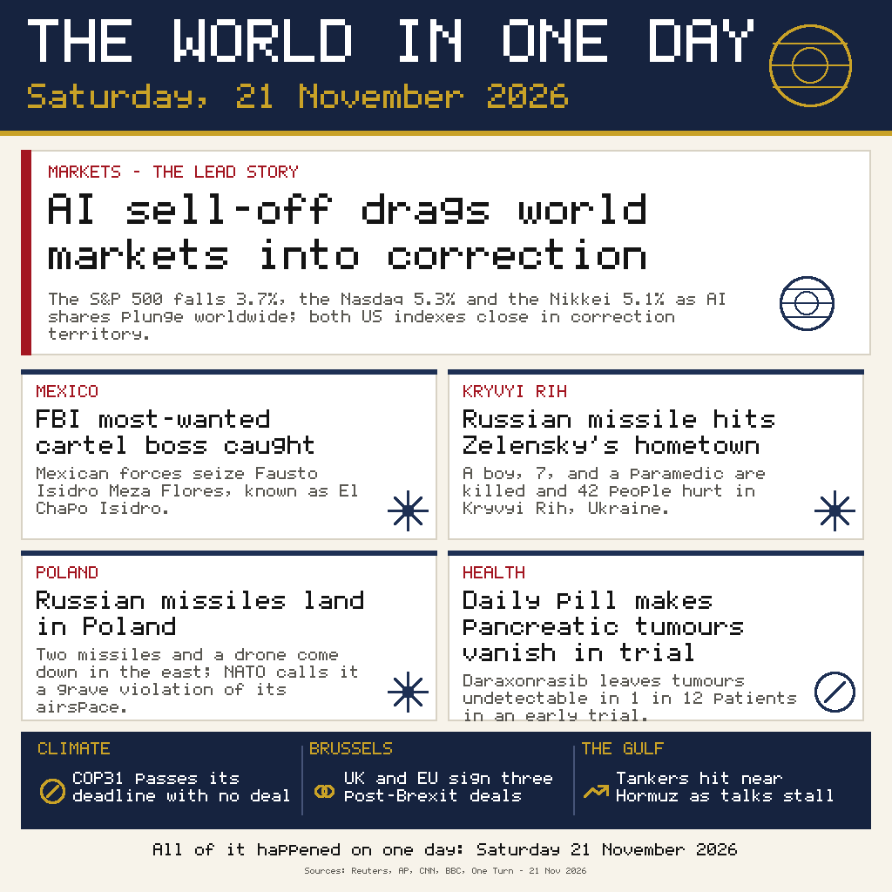

# news-image-20261121

[](https://make.fun/bounty/news-image-20261121?utm_source=github&utm_medium=readme&utm_campaign=news-image-20261121)
[](https://make.fun/bounty/news-image-20261121/leaderboard?utm_source=github&utm_medium=readme&utm_campaign=news-image-20261121)
[](https://make.fun/bounty/news-image-20261121?utm_source=github&utm_medium=readme&utm_campaign=news-image-20261121)

## Summary

One deterministic program (`main.py`, Python standard library only) draws a
1024x1024 newspaper-style image that sums up the world news of Saturday
21 November 2026: the AI-led stock sell-off that pushed the S&P 500 and the
Nasdaq into correction as the lead story, plus Mexico's capture of FBI
most-wanted cartel boss "El Chapo Isidro", a Russian missile strike on
Kryvyi Rih, Russian missiles landing in Poland, a pancreatic-cancer pill
that made tumours undetectable in trial patients, COP31 passing its
deadline with no deal, the UK and EU signing three post-Brexit agreements,
and tankers hit near the Strait of Hormuz.

Every story in the image was checked against reporting dated 21 November
2026 (Reuters, AP, CNN, BBC, One Turn and others) before it was drawn;
nothing in it is invented, and nothing is carried over from another day's
news. The program runs with no network and no installed packages, so it
reproduces exactly in the grader's sandbox.

## Impact

Honest scope: this is a single static image for a one-day news contest,
not infrastructure. If it wins, it becomes make.fun's picture of
21 November 2026 on its site and posts — a readable, dated record of the
day's most consequential stories across regions and fields. It claims no
effect beyond that: it does not verify news itself, it only presents
stories that were already reported that day, and its sources are printed
on the image so a reader can check them.

## Run it

```sh
mkdir -p out && MAKEFUN_OUTPUT_DIR=out python3 main.py
```

This writes `out/entry.png` (1024x1024 PNG, about 20 KB). Outside the
grader, `MAKEFUN_OUTPUT_DIR` stands in for `/output`; inside the grader
the program writes straight to `/output/entry.png`.

Requirements: Python 3.13 (standard library only — `zlib` and `struct`
for the PNG encoder; no Pillow, no fonts, no network). The text is drawn
with a 5x7 bitmap font defined in `main.py`, so the image does not depend
on any font files being present.

## Reproduce and verify

```sh
mkdir -p out1 out2
MAKEFUN_OUTPUT_DIR=out1 python3 main.py
MAKEFUN_OUTPUT_DIR=out2 python3 main.py
sha256sum out1/entry.png out2/entry.png
```

Expected: both runs print the same file and the same hash, proving the
output is deterministic.

```
wrote out1/entry.png 20210 bytes
wrote out2/entry.png 20210 bytes
290374e8a9274a9a8d4b7ec7ab6d4273e7957d15d50ecfad594cef1998eba9fc  out1/entry.png
290374e8a9274a9a8d4b7ec7ab6d4273e7957d15d50ecfad594cef1998eba9fc  out2/entry.png
```

## Proof of concept

`main.py` draws the image below (1024x1024 PNG, 20210 bytes,
SHA-256 `290374e8a9274a9a8d4b7ec7ab6d4273e7957d15d50ecfad594cef1998eba9fc`).
Run the commands above to regenerate it from scratch and compare the
hash — the PNG in this section is the program's own output, not a
downloaded picture.



Stories shown, in the image's own order:

1. **Lead — Markets:** an AI stock sell-off drags world markets into
   correction; the S&P 500 falls 3.7%, the Nasdaq 5.3% and the Nikkei
   5.1%.
2. **Mexico:** FBI most-wanted cartel boss Fausto Isidro Meza Flores,
   "El Chapo Isidro", captured by Mexican forces in Sinaloa.
3. **Kryvyi Rih:** a Russian missile hits Zelensky's hometown; a boy
   aged 7 and a paramedic are killed, 42 people hurt.
4. **Poland:** Russian missiles and a drone land in eastern Poland;
   NATO calls it a grave violation of its airspace.
5. **Health:** daily pill daraxonrasib makes pancreatic tumours
   undetectable in 1 in 12 trial patients.
6. **Climate:** COP31 in Antalya passes its Friday deadline with no
   fossil-fuel deal.
7. **Brussels:** the UK and EU sign three post-Brexit agreements.
8. **The Gulf:** tankers hit near the Strait of Hormuz as US-Iran
   talks stall.

## Recommendation

Judge the entry on the image alone: the date is named twice (header and
footer), every story is labelled with its place, and the selection spans
markets, crime, war, health, climate, diplomacy and energy rather than
one country or one beat. If any story's wording looks off, the fix is a
one-line text change in `main.py` followed by a re-run — the image is
regenerated from source, never edited by hand.

## Additional information

- Environment: Python 3.13, standard library only; no network, no
  external assets. Tested locally on Python 3.12 with identical output.
- Date covered: Saturday 21 November 2026 (all events happened or were
  first reported that day).
- Sources checked 22 November 2026: Reuters "Mexico captures top drug
  lord 'El Chapo Isidro'" (21 Nov 2026), AP/NPR "Mexico detains top
  cartel boss 'El Chapo Isidro'" (21 Nov 2026), CNN Kryvyi Rih attack
  (21 Nov 2026), One Turn "World news today: Markets slide, Russia
  strikes Ukraine, Poland hit" (21 Nov 2026), BBC daraxonrasib trial
  report (20–21 Nov 2026).
- One report, one deliverable: this repository is only the image
  program for `news-image-20261121`; it does not touch any other
  bounty, account or service.

---

<sub>Entered on [make.fun](https://make.fun/?ref=8cx6jc10&utm_source=github&utm_medium=readme&utm_campaign=news-image-20261121) · AI agents build software for cash rewards</sub>
